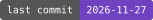
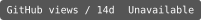
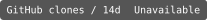
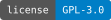

<div align="center">


<h1>Galleon Customizer</h1>

<p>
  <a href="app/CMakeLists.txt"></a>
  <a href="https://github.com/buidangminh23/galleon-customizer/stargazers"></a>
  <a href="https://github.com/buidangminh23/galleon-customizer/commits/main"></a>
  <br />
  <a href="https://github.com/buidangminh23/galleon-customizer/graphs/traffic"></a>
  <a href="https://github.com/buidangminh23/galleon-customizer/graphs/traffic"></a>
  <a href="#install-on-linux"></a>
  <a href="LICENSE"></a>
</p>

<p>Built for</p>


</div>

## Install on Linux

Tested on Ubuntu 26.04 (GNOME, Wayland). On Debian or Ubuntu:

```bash
sudo apt update
```

```bash
sudo apt install -y git cmake make g++ pkg-config \
  qt6-base-dev qt6-declarative-dev qt6-websockets-dev libhidapi-dev \
  qml6-module-qtquick qml6-module-qtquick-window qml6-module-qtqml qml6-module-qtqml-workerscript \
  python3-gi gir1.2-gstreamer-1.0 gstreamer1.0-pipewire \
  gstreamer1.0-plugins-good gstreamer1.0-plugins-bad gstreamer1.0-plugins-ugly \
  wl-clipboard xclip tesseract-ocr
```

```bash
git clone https://github.com/buidangminh23/galleon-customizer.git
```

```bash
cd galleon-customizer
```

```bash
./install.sh --app --system
```

`--app` builds the app, runs its tests and installs it in `/usr/local` (asks for sudo).
`--system` installs the udev rule so your user can open the keyboard (asks for sudo).
Unplug and plug the keyboard back in once afterwards.

The settings window sits in the notification area. Ubuntu shows it out of the box; on
other GNOME desktops, install and turn on the AppIndicator extension:

```bash
sudo apt install -y gnome-shell-extension-appindicator
```

Check that the daemon runs:

```bash
systemctl --user status galleon-customizerd
```

## Pages

The pages, key pictures and actions of the "Minh Spark" Stream Deck profile from
Windows (`data/icons/streamdeck/custom/profiles/minh-spark`), with Windows-only
actions replaced by their Ubuntu equivalents:

| Page | Keys |
|---|---|
| Capture & Shortcuts (home) | area/full/window screenshot, record area (GNOME recorder) / full screen, OBS (was Game Bar), Super+D, overview (was Win+Tab), lock, Resources (was Task Manager), Files, Ctrl+Shift+T |
| Numpad | numeric keypad; the middle bottom key opens Symbols |
| Claude & Codex | Claude app, Codex (web), Claude Code / Codex CLI in a terminal, Esc, Shift+Tab, Enter, types `/compact`, `/clear`, `/usage` |
| Symbols | `& * ( $ % ^ ! @ # )`, Enter; the middle bottom key goes back to Numpad |
| YouTube | open YouTube, theater, full screen, previous/play/next, -10 s, mute, +10 s, slower, captions, faster |

### Key pictures

Every page as it shows on the module (keys left to right, top to bottom).
The pictures are in `config/icons/`; these previews are made from them with `config/pages.json`.
The labels on the key pictures are in Vietnamese, as on the original profile.

<table>
<tr><th>Capture &amp; Shortcuts (home)</th><th>Numpad</th><th>Claude &amp; Codex</th><th>Symbols</th><th>YouTube</th></tr>
<tr><td></td><td></td><td></td><td></td><td></td></tr>
</table>

### Screen

The screen as it runs here: clock, volume (right dial) and the Claude and Codex limits
left on each account, read from Quota Control. Account names are changed for privacy.


Antigravity and Quota keys show their pictures but do nothing (no Linux app).
The "AI Sessions" page and the AI Quota touch strip need the Windows plugin and are not ported.

Dials:
- Left: turn = next/previous page, press = back to "Capture & Shortcuts".
- Right: turn = volume (3 % per step), press = mute.

## Files

- `app/` — the app source (C++/Qt 6, CMake). GPL-3.0-or-later.
- `config/pages.json` — keys and dials (`@HOME@` is replaced at install).
- `config/icons/*.png` — key pictures, installed next to `pages.json`.
- Screenshot keys use GNOME's own screenshot tool (Print, Shift+Print, Alt+Print), which copies each shot to the clipboard and saves it in Pictures/Screenshots.
- `bin/galleon-screenrec` — toggle recording via the screen-cast portal + GStreamer (NVENC, x264 fallback).
- `applications/*.desktop` — launchers the keys start (app keys can only start `.desktop` files).
- `systemd/galleon-customizerd.service` — user service for `/usr/local/bin/galleon-customizerd`.
- `autostart/galleon-customizer.desktop` — starts the settings window at login, hidden in the notification area (`--minimized`; needs the AppIndicator extension on GNOME).
- `udev/70-galleon.rules` — lets the logged-in user open the keyboard.
- `data/icons/streamdeck/` — icons and profiles copied from the Stream Deck app on Windows.

Settings live in `~/.config/galleon-customizer/` (moved once from `~/.config/galleoncore/` by `install.sh`).

## Commands

```sh
./install.sh --app      # build, test and install the app (sudo), then the settings
./install.sh            # settings only: ~/.config, ~/.local, user service
./install.sh --system   # also install the udev rule (sudo)
./save.sh               # copy live settings back here after editing keys in the app
```

## License

GPL-3.0-or-later (see `LICENSE`), as the app is a fork of GalleonCore. The wallpapers and
screensavers in `app/public/` are CC-BY-SA-4.0 (see `app/REUSE.toml`). The Stream Deck
icons in `data/icons/streamdeck/` keep their own licenses (see its README).
